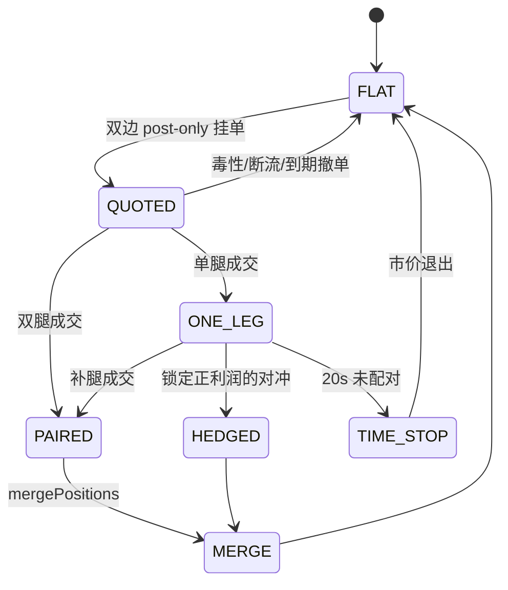

# BTC 5m Up/Down 刷量方案（btc5m 分支）

日期：2026-11-24
范围：只做 Polymarket `btc-updown-5m-*`，不碰 Lane A 奖励市场。
目标：保持高胜率、把磨损压到接近 0、交易本身正期望，用 maker 返点做补贴。
结论先说：**“主要依赖挂单奖励”在当前 btc5m 上不成立；taker 返点也不能作为刷量利润来源。**
btc5m 唯一结构上成立的模式是“延迟保护的双边 maker + 配对成交”，利润来自 2δ 价差，
返点只是补贴；单边成交是唯一真实风险，必须用 250ms 延迟撤单、库存箱、时间止损和到期强平压住。

---

## 0. 三个直接回答

### 0.1 挂单奖励：btc5m 现在是 0

2026-11-24 07:44Z 对当前 `btc-updown-5m` 市场的实测：

```bash
curl -s "https://clob.polymarket.com/rewards/markets/0x6fcca59e9217b801bcfc0c6f6723fa7ff5b579f647c5103ae572cc088757045f"
# -> {"data":[],"next_cursor":"LTE=","limit":100,"count":0}
```

`clob-markets` 里仍然有奖励**设置**（`r: {mi: 50, ma: 4.5, moas: 30}`），
但 `rewards_config` 是空数组；本次抽样的 `/rewards/markets/{condition_id}` 为空，
研究记录中 `/rewards/markets/current` 全量也没有 up/down 家族。
官方文档的 Crypto TWAP Rewards 页面明确写着：

> This program has ended. The August allocation is no longer active.

所以“挂在中间价附近不成交也拿奖励”这条你手动时期吃到的路径，在 btc5m 上已经关闭。
奖励设置还在，只说明未来可能重新打开；不能当作当前收入。

### 0.2 maker 返点：存在，但很小

官方 Maker Rebates Program（当前文档）：

```text
wV        = C × p × (1 - p)                  # 30 天 maker 加权成交量
fee_equiv = C × feeRate × p × (1 - p)        # 你这笔 fill 产生的 taker 费
rebate    = fee_equiv × maker_tier_rate      # 3% / 7% / 10% / 15%
```

BTC 5m 的 `feeRate = 0.05`。官方明确 maker wV 包含 BTC 5m/15m 市场，所以 btc5m 的 maker fill 确实能累积 tier。
在 p = 0.50 时：

| maker 层级 | 30 天 wV | 每 fill 返点/股 | 占名义 | 每对返点/2c 价差 |
|---|---:|---:|---:|---:|
| None | < 200k | 0 | 0 | 0 |
| Tier 1 | 200k–1M | 0.000375 | 0.075% | 3.75% |
| Tier 2 | 1M–4M | 0.000875 | 0.175% | 8.75% |
| Tier 3 | 4M–10M | 0.00125 | 0.25% | 12.5% |
| Tier 4 | ≥ 10M | 0.001875 | 0.375% | 18.75% |

也就是说，即使做到 Tier 4，返点也只有 2c 配对价差的 18.75%。**返点不能覆盖一次 5c 的单边错单。**
它只能在价差已经为正的前提下加一点收益。
注意：上表的“每对返点”按两腿都是 maker fill 计；如果一条腿是 taker 对冲，
那条腿不计 maker wV、不产生 maker 返点（只产生 taker wV 与 taker 返点），返点大约减半。

### 0.3 taker 返点：存在，但纯 taker 刷量必亏

Taker Rebate Program 的返点是“你付的 taker 费的 10%–60%”，不是倒贴。
BTC 5m、p = 0.50 时，taker 费 = `0.05 × 0.5 × 0.5 = 0.0125 pUSD/股`，占名义 **2.5%**。

| taker 层级 | 30 天 wV | 返点 | 净费/股 | 净费占名义 |
|---|---:|---:|---:|---:|
| Gold | 200k–1M | 10% | 0.01125 | 2.25% |
| Platinum | 1M–4M | 25% | 0.00938 | 1.875% |
| Diamond | 4M–10M | 40% | 0.00750 | 1.50% |
| Obsidian | 10M–75M | 50% | 0.00625 | 1.25% |
| Onyx | ≥ 75M | 60% | 0.00500 | 1.00% |

一次 taker 往返至少再叠加 1c 价差；即使 Onyx，净费往返也有 ≈ 2%，再加价差。
只有当你已经有独立的方向 edge（例如 Chainlink TWAP 领先市场），taker 返点才是成本折扣；
它本身不是刷量利润来源。极端价格（0.95）费低，但 wV 累积慢 10 倍，且一旦看错损失的是全部 stake。

---

## 1. 线上事实底座（2026-11-24 复核）

| 项目 | 观测值 | 来源 |
|---|---|---|
| 市场 | `btc-updown-5m-1795506000`，5 分钟，Up/Down | Gamma |
| 结算 | Chainlink BTC/USD **60s TWAP**，final ≥ start 则 Up | 市场 description |
| price to beat | **不在** Gamma/CLOB 公开字段；需 Chainlink Data Streams / PolyBolt `prices.crypto.twap` | `.research/poly-platform.md` §6.2 |
| 流动性奖励 | `rewards_config: []`，`/rewards/markets/{cid}` 为空 | 本次实测 |
| taker 费系数 | `fd.r = 0.05`（BTC 5m/15m） | `clob-markets` |
| maker 费 | 0 | 官方 Fees |
| tick | 0.01 | `mts: 0.01` |
| 最小单量 | 5 股 | `mos: 5` |
| taker delay | 250ms，`itode: true`；**taker 单**在延迟期间不可撤 | `clob-markets` + docs |
| 最小挂单年龄 | `moas: 30`（字段语义未完全确认；btc5m 当前无奖励，不影响本方案） | `clob-markets` |
| 系列 24h 量 | ≈ $13.7M；流动性 ≈ $4.17M | Gamma series |
| 单窗口典型深度 | 最优档数十到数百股，1c 价差常见 | 本次盘口采样 |

**关键更正：** 讨论方案里“Polymarket 挂单奖励依然保留且无门槛”的说法，对 btc5m 不成立。
那是旧版/其他市场的机制；btc5m 的 Crypto TWAP 奖励池已经结束。

**关键缺口：** OKX/币安现货只能做短周期毒性探测，不能替代 Chainlink TWAP 做结算概率。
两者基差在价格贴近 strike 时会直接决定 0/1，所以 Lane T（方向/狙击）必须先拿到 Chainlink 数据。

---

## 2. 钱从哪来：配对成交，而不是返点

Polymarket 的 1 份 Up + 1 份 Down 可以通过 CTF `mergePositions` 换回 1 pUSD。
双边挂买单：

```text
bid_up   = p - δ
bid_down = (1 - p) - δ
```

两边都成交时，你付 `1 - 2δ`，merge 回 1，**毛利 = 2δ / 组，与涨跌无关**。
δ = 1c 时每组 2c；δ = 2c 时每组 4c。这是唯一不依赖方向的正期望来源。

单边成交时，你持有一个方向性二元头寸。若成交后公允概率从 p 变到 p - a，
你的 mark loss ≈ `(a - δ) × 股数`。如果价格直接走到 0/1，损失就是全部本金。
这就是“磨损”。它不是手续费，而是**逆向选择**。

对冲单边腿的即时成本（taker 买另一腿）：

```text
总成本 = (p - δ) + (1 - p + φ) + fee_t
       = 1 + φ - δ + fee_t
```

p = 0.5 时 `fee_t = 1.25c/股`，φ 是另一腿的半价差（通常 0.5c–1c）。
所以：

- δ = 1c，φ = 0.5c → 成本 = 1 + 0.75c，**对冲即亏 0.75c/股**；
- δ = 2c，φ = 0.5c → 成本 = 1 - 0.25c，**锁定 0.25c/股**；
- δ = 3c，φ = 1c → 成本 = 1 - 0.75c，**锁定 0.75c/股**。

结论：**1c 半价差 + 即时 taker 对冲是负的。**
要么用 2c 以上的半价差换取“可对冲的零磨损”，要么接受 1c 报价但承担单边风险。
这是本方案最重要的参数取舍。

---

## 3. 生死线：配对率 P 与单边损失 L

先把三个“胜率”拆开，避免混用：

- **组合胜率**：已 merge 的配对组里毛利为正的比例。按 `2δ > 0` 构造，恒为 100%，不是预测能力。
- **周期完成率 P**：一个报价周期内双腿都成交的比例。这是 Lane P 真正的生存指标。
- **方向胜率**：Lane T 对最终 0/1 的预测准确率。只有 Lane T 才讨论这个。

“0 磨损”也严格定义：**只有配对成交、maker 费为 0、merge 回收 1 pUSD 时成立。**
单边成交一定有磨损（逆向选择）；taker 对冲的费、链上 gas、relayer 成本也都是磨损。
本方案不把“单边扛到结算”算作 0 磨损。

定义（每个报价周期、每组 1 股 Up + 1 股 Down）：

- `P` = 双腿都成交的概率（paired fill ratio）
- `L` = 单边成交时的平均损失/股（含逆向选择，不含返点）
- `G = 2δ` = 配对毛利/组
- `R` = maker 返点/组（Tier 1 约 0.00075，Tier 4 约 0.00375）

期望：

```text
E = P × G - (1 - P) × L + R
```

返点 R 相对 G 很小，做生死线时可以先忽略，得到保守判据：

```text
P* = L / (G + L)
```

δ = 1c（G = 2c）时：

| 单边平均损失 L | 需要的最低配对率 P* |
|---:|---:|
| 1c | 33.3% |
| 2c | 50.0% |
| 3c | 60.0% |
| 5c | 71.4% |
| 10c | 83.3% |
| 20c | 90.9% |

5m BTC 单边逆向选择常见 5c–20c，所以**朴素双边挂单需要 85%–90% 的配对率才能不亏**。
这正是上一轮实盘（ADR 0013）亏钱的结构原因：单边成交被当成方向单扛到结算，且没有库存上限。

每 100 个报价周期、S = 20 股的净损益（忽略返点，pUSD）：

| P \ L | 2c | 5c | 10c |
|---:|---:|---:|---:|
| 90% | +32 | +26 | +16 |
| 85% | +28 | +19 | +4 |
| 80% | +24 | +12 | -8 |
| 70% | +16 | -2 | -18 |

同场景 Tier 1 返点只有约 +1.4 pUSD/100 周期，Tier 4 约 +7.1 pUSD。
**返点改变不了上表的符号。**

把损失换成可感知的量：20 股一腿时，一次 5c 的单边逆向损失 = $1.00；
δ=1c 的一组配对毛利 = $0.40，所以**一次 5c 错单抵消 2.5 组配对**；δ=2c 时抵消 1.25 组。
这就是为什么“高配对率”比“高返点”重要。

**量不是瓶颈。** 按你给的 100x–1000x/日，$1,400 本金对应日名义 $140k–$1.4M；
30 天名义 $4.2M–$42M。p=0.5 时 wV = 0.5 × 名义，即 $2.1M–$21M，
已经落在 Tier 2–Tier 4。只要成交是真的，返点层级很容易到；
真正决定生死的是 P 和 L。不要为了冲 tier 放大 size 或放宽价差。

---

## 4. 策略设计

### 4.1 默认 Lane P：延迟保护的双边 maker

核心不是“挂中间价”，而是**在 250ms taker delay 内撤掉即将被吃的单**。
`itode: true` 表示 marketable taker 单先被 hold 250ms 再匹配；maker 的撤单如果先到，
就能避免这笔成交。这是 btc5m 上唯一可能把单边损失压到价差以内的结构性优势。
**这条机制目前是 UNVERIFIED，必须先做 staging 实测（见 P3）。**

状态机：



**报价**

- 公允价：盘口 microprice + OKX bbo-tbt 短周期动量；Lane P 不需要精确 Chainlink strike。
- 定价原则：Lane P 以盘口 mid/microprice 为主锚，OKX 只做毒性前馈；不要用 Black-Scholes 去覆盖市场共识，5m 盘的速度比模型精度重要。二元期权公式只在 Lane T 用。
- 双边买价：`bid_up = p - δ`，`bid_down = (1 - p) - δ`，强制 `bid_up + bid_down ≤ 1 - min_margin`。
- δ 自适应：平静 1c，正常 2c，毒性 3c 或直接停；最小 1 tick。
- 强制 `post_only=true`；穿价直接拒单，杜绝 taker 费。
- 只在 `mid ∈ [0.15, 0.85]` 报价；贴边时单边跳变最猛，且 wV = p(1-p) 低，不划算。
- 单市场单边最大库存 = 2×下单量（20 股时 40；50 股时 100）；禁止加仓摊平。

**毒性撤单（核心）**

- 订阅 OKX `bbo-tbt`，维护 1s/250ms 价格变化。
- 单次跳变超过 `max(6 bps, 3×σ_1s)`，或行情断流 > 500ms，立即撤双边。
- 撤单预算 < 150ms（同区域部署，东京/新加坡优先）；用按市场撤单，不用 `cancel-all`（会把撤单令牌桶打成负数）。
- 每次毒性事件记录 `cancel_win`：撤单是否早于 taker delay 释放。这是上线前的硬指标。

**单腿处理（不允许默认扛到结算）**

1. 成交后 0–1s 内读另一腿真实 ask；
2. 若 `ask_other + fee_other < 1 - bid_filled - h`，立即 taker 对冲，锁定 `h`（默认 0.5c/股）；
3. 否则在 `1 - bid_filled - h` 挂 maker 补腿，等待 ≤ 20s；
4. 20s 未成交 → 用可成交限价/市价退出（接受有界损失）；只有 Lane T 模型明确给出 edge 时才允许持有到结算；
5. 任何情况下不再加同侧仓。

**到期**

- T−45s 撤全部挂单；
- T−20s 前清掉单边库存；不留敞口进最后 20s（5m 盘最后几秒可以 0.02↔0.98 翻转）；
- 配对仓位批量 merge，proxy 钱包走 relayer（gasless），EOA 走链上并计 gas；gas 也是磨损，必须计入。

**资金与规模**

- 1,400 pUSD，单市场一对 20 股约占用 20 pUSD；3 个市场约 60，10 个约 200，余量充足。
- 先 1 个市场 × 20 股跑 7 天；配对率 ≥ 85%、单边损失 ≤ 2c/股后再加到 3–10 个市场、50 股。
- 每个 5m 窗口独立结算；跨市场不要共享库存假设。

### 4.2 可选 Lane T：最后 60 秒的 Chainlink TWAP 狙击（不是刷量）

如果目标是“高胜率 + 正利润”，而不是纯 maker 刷量，Lane T 比 Lane P 更直接：

- 前提：拿到 Chainlink Data Streams / PolyBolt `prices.crypto.twap`，能重建本窗口的 price to beat；
- 时点：T−30s 到 T−5s；最终 60s TWAP 窗口已走完大部分，剩余时间越短确定性越高；
- 动作：当 `P_model - ask - fee > edge`（edge ≥ 2c/股）时，taker 买接近确定的一侧；
- 胜率目标 > 90%，但**必须同时看期望值**；90% 胜率配上大额尾部亏损仍可能是负期望；
- 这是有尾部的方向策略，不是“0 磨损”；
- 极端价格费低（0.95 处 0.25%），taker 返点只是折扣；wV 累积慢，别指望它刷 tier；
- 没有 Chainlink key 之前，Lane T 不上线；OKX 现货替代不了结算源。

### 4.3 明确不做

- **挂单奖励农场**：btc5m 当前分配为 0，挂了也不发。
- **纯 taker 刷量**：净费 1.0%–2.25% + 价差，必亏。
- **自成交/多账号对敲**：ToS 明确可取消返点并封号；本方案只做真实对手盘。
- **单边扛到结算**：这是 ADR 0013 亏 100 pUSD 的主因，不作为默认。

---

## 5. 默认参数

| 参数 | 默认 | 说明 |
|---|---:|---|
| 下单量 | 20 股/腿 | 实测通过后升到 50 |
| 并发市场 | 3 | 验证后最多 10 |
| 半价差 δ（平静/正常/毒性） | 1c / 2c / 3c | 1c 只在高配对率 regime 用 |
| 最小配对毛利 | 1.5c/组 | 低于此不报 |
| 单市场最大单边库存 | 2×下单量（20 股时 40；50 股时 100） | 禁止金字塔 |
| 对冲锁定利润 h | 0.5c/股 | 不满足就不对冲 |
| 单腿时间止损 | 20s | 超时市价退出 |
| 到期撤单 | T−45s | 强制 |
| 到期清仓 | T−20s | 强制 |
| 毒性阈值 | 6 bps / 1s | 按 σ 校准 |
| 行情断流 | 500ms | 立即撤单 |
| 单日最大亏损 | 3% 权益 | 触发停机 |
| 最大回撤 | 10% | kill switch |
| merge 批量 | 5 分钟 / 10 个 condition | 摊销 gas |
| API 预算 | 下单 < 40/s，撤单 < 80/s | 批量全有全无，留余量 |

---

## 6. KPI 与停机规则

每日必须落盘：

| 指标 | 目标 | 说明 |
|---|---:|---|
| `pair_ratio` | ≥ 85% | 配对成交 / 报价周期 |
| `single_leg_loss_cents` | ≤ 2c/股 | 单边平均逆向损失 |
| `net_bps` | > +20 bps/组 | 扣费、gas 后 |
| `cancel_win_rate` | ≥ 90% | 毒性撤单赢过 250ms |
| `fill_rate` | 记录 | 不设硬目标，先测 |
| `maker_wv_30d` | 记录 | `/v1/maker-tier/tiers` |
| `rebate_usd` | 记录 | `/rebates/current`，最低 $1 才发 |
| `gas_usd` | 记录 | merge/split/redeem |
| `max_drawdown` | < 10% | 硬停机 |

停机条件（任一）：

- 滚动 100 笔净损益 ≤ 0；
- 200 个报价周期 `pair_ratio < 70%`；
- 单边平均损失 > 3c/股；
- `cancel_win_rate < 70%`；
- 行情断流占比 > 1%；
- 单日亏损 > 3% 权益；
- 出现任何自成交/风控告警。

---

## 7. 实施路线与验收

**P0 事实底座（已完成）**
本文 §1 的线上读数，命令可复跑。验收：`rewards_config` 为空、`fd.r=0.05`、`itode=true`、`mos=5`、`mts=0.01`。

**P1 72 小时录制 + 离线模拟**
录制：两个 token 的 BBO/深度、public trades、OKX BBO、Gamma 元数据；有 Chainlink key 则加 TWAP。
模拟 δ = 1c/2c/3c、S = 20/50，输出 P、L、net_bps 分布。
验收：每个 regime（趋势/震荡/高波动）至少 200 个窗口；给出 P 的置信区间和 P* 对比。
**如果 P 的 95% 下界低于 P*，不上线。**

**P2 执行骨架**
复用 `polymarket-mm` 的 `clob.py`、`heartbeat.py`、`positions.py`、`merge.py`；
新增 btc5m 窗口调度、价格源、毒性撤单、单腿状态机。
验收：dry-run 能连续切换 20 个窗口，无重复 token、无过期 condition。

**P3 staging 撤单竞速（决定成败）**
在 `clob-staging` 上：挂 100 次双边单，制造/等待 250ms 延迟窗口，测撤单是否赢。
验收：`cancel_win_rate ≥ 90%`，撤单 p99 < 150ms；故意不撤时能观察到单边成交。
**不过这一关，Lane P 不上实盘。**

**P4 小额实盘**
1 个市场、20 股、7 天、≤ 200 pUSD 敞口。
验收：`pair_ratio ≥ 85%`、`single_leg_loss ≤ 2c/股`、净损益 > 0、最大回撤 < 3%。
每日对账：`GET /data/trades`、`/v2/positions`、链上余额、`/rebates/current`。

**P5 扩容与返点验证**
3 → 10 个市场，20 → 50 股；跟踪 `maker_wv_30d` 与实际 rebate。
验收：30 天净损益 > 0；返点到账与 `fee_equiv × tier` 对得上；若返点占比 > 50% 才盈利，视为不通过（说明价差本身不成立）。

**P6 复盘与 Lane T 决策**
用实测 P/L 决定是否投入 Chainlink key 做 Lane T；不做模糊表述。

---

## 8. 待验证问题

1. **250ms 撤单竞速是否真的能阻止成交**：这是整个 Lane P 的前提，必须 staging 实测。
2. **price to beat 的重建误差**：Chainlink 60s TWAP 的窗口起点值；OKX 现货基差有多大。
3. **配对率的 regime 依赖**：趋势市里 P 可能远低于 85%；需要按波动率分层统计。
4. **maker wV 的统计口径**：`C × p × (1-p)` 与 $200k 阈值的单位解释；以 `/v1/maker-tier/tiers` 的实际返回为准。
5. **返点到账时点与最低 $1**：每日发放，但 tier 是每日快照。
6. **奖励是否重新开放**：持续轮询 `/rewards/markets/current`；一旦有分配，再评估是否回到挂单奖励模式。
7. **merge 的 gas/relayer 限额**：批量大小与成本。

---

## 9. 建议

1. **不要在 P1/P3 通过前投入实盘。** 这套方案的 edge 是“延迟 + 配对”，不是返点；延迟竞速没验证，就是在重复 ADR 0013 的单边亏损。
2. **默认用 2c 半价差 + 可锁定的 taker 对冲**，先把“0 磨损”做成可控；等 P3 证明撤单率 ≥ 90%，再降到 1c 抢量。
3. **返点按 Tier 1 做预算，不要按 Tier 4 做预算。** p=0.5 时 Tier 1 只需 800k 股/30 天：20 股一腿约每天 667 个配对，50 股一腿约每天 267 个配对；价格偏离 0.5 会需要更多股。真正的约束是配对率，不是资金。
4. **如果 P1 的配对率下界低于生死线，btc5m 不适合“0 磨损 + 正利润 + 刷量”三件事同时成立。** 那时应二选一：回到有奖励的 Lane A 市场，或用 Chainlink 做 Lane T 的方向 edge，而不是继续在 btc5m 上刷。
5. **“taker 返点”只能当折扣。** 净费最低也有 1%（50c、Onyx），纯 taker 刷量没有正期望；除非你已经有独立 edge。

---

## 10. 实施状态（2026-11-24）

- P1 录制器：`btc5m/recorder.py`，一次约 46 分钟采集（12 个窗口，操作者提前停止），Polymarket 前 50 档、OKX 前 20 档、两场馆逐笔成交、CLOB 结算。
- 离线模拟器：`btc5m/simulator.py`，输出 `touch` 与 `queue` 两套 P、单边损失、`net_bps` 分布和返点估算。
- P3 撤单测试：`btc5m/cancel_test.py`，默认 dry-run；离线 `--replay` 用假设的撤单延迟计算自然竞速。强制 250ms 竞速仍需第二个出资账户，未执行。
- 预测检验：`btc5m/predictive.py`，留一窗口逻辑回归。1 小时样本低于 30 个窗口，按设计返回 `inconclusive`。
- 结算补齐：`btc5m/backfill.py`，用于录制结束时尚未关闭的窗口。
- 报告：`btc5m/report.py`，汇总覆盖、模拟器、预测检验和撤单回放。

当前证据：

- btc5m 挂单奖励为 0；maker 返点只占 2c 价差的 3.75%–18.75%；taker 净费仍为 1.0%–2.25%。
- 1c tick 下，20 股新单通常排在 150–2500 股后面；`queue` 模型在部分窗口给出 0 次配对。成交概率，而不是返点，是主要约束。
- OKX 前 20 档深度失衡对 1–5 秒方向有信号（swap 1s 命中约 69.5%，样本未做显著性校正），对 5 分钟结算没有结论。

下一步：用完整 1 小时和后续多日样本重跑 `queue` 模型；如果配对率仍接近 0，btc5m 纯 maker 刷量不成立，转向 Lane T 或回到有奖励的市场。
